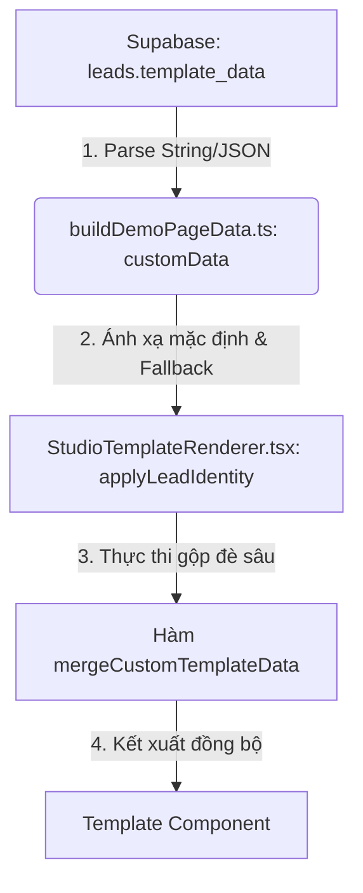

# Source Of Truth - Demo Renderer Rules

Cập nhật: 2026-10-21.

Demo renderer là phần render website demo public theo `place_id`. Route `/demo/[place_id]` phục vụ việc hiển thị giải pháp website theo thương hiệu của khách hàng hoặc làm trang demo mẫu cho từng ngành.

## Mục tiêu

Khi truy cập:

```txt
/demo/{place_id}
```

Hệ thống xử lý qua luồng logic:

1. Lấy `place_id` từ URL.
2. Gọi `getBusinessByPlaceId(place_id)` để fetch từ Supabase table `leads` hoặc PostgreSQL pool.
3. Nếu không tìm thấy lead hoặc là mock URL, fallback sang `getMockLeadByPlaceId(place_id)`.
4. Xác định ngành nghề bằng `routeTemplateByIndustry(lead.industry)`.
5. Lấy danh sách template render sẵn có của ngành từ `getTemplatesByIndustry(industryKey)`.
6. **Kiểm tra phân nhánh giao diện**:
   - **Trường hợp A (Khách hàng thực tế & ngành có > 1 template render, chưa chọn `?template=`)**:
     Hệ thống hiển thị **Industry Template Hub** (`IndustryTemplateHub.tsx`) để khách hàng xem các thẻ mẫu, hover cuộn ảnh dài và bấm chọn xem demo trực tiếp.
   - **Trường hợp B (Link demo mẫu canonical `/demo/mock-{industry_key}`)**:
     Bỏ qua Hub và chuyển thẳng vào **Mẫu 1 (XD001)** để người xem trải nghiệm ngay một website mẫu hoàn chỉnh.
   - **Trường hợp C (Có tham số `?template={templateKey}`)**:
     Chuyển thẳng vào template được chỉ định (ví dụ: `?template=xay_dung_2`, `?template=xay_dung_3`, `?template=XD003`, `?template=NT003`, hoặc `?template=cong_ty_xay_dung`), nạp dữ liệu của lead vào template đó.
7. Build `DemoPageData` bằng `buildDemoPageData` (tự động phân tích cú pháp cột JSON `template_data` nếu có).
8. Áp dụng đè dữ liệu động qua hàm ghép lồng sâu `mergeCustomTemplateData` ở `StudioTemplateRenderer.tsx` (hoặc data adapter chuyên dụng của template độc lập).
9. Render template qua `DemoTemplateRenderer` (phân nhánh sang `XayDung3Renderer`, `XayDung2Renderer` hoặc `StudioTemplateRenderer`).

## Không được tạo trong route demo

- Dashboard / Cấu hình phức tạp cho khách hàng.
- Form nhập tên doanh nghiệp thủ công.
- Live editor làm rối giao diện demo.

## File chính

| File | Vai trò |
|---|---|
| `src/app/(public)/demo/[place_id]/page.tsx` | Fetch lead, kiểm tra phân nhánh Template Hub, build data, render template |
| `src/app/(public)/demo/[place_id]/not-found.tsx` | Trang fallback khi không có lead |
| `src/app/(public)/xay-dung-2/page.tsx` | Trang demo standalone độc lập của mẫu XD002 (Prague Architecture) |
| `src/app/(public)/xay-dung-3/page.tsx` | Trang demo standalone độc lập của mẫu XD003 / NT003 (BIM Architecture & Interior) |
| `src/components/demo/IndustryTemplateHub.tsx` | Giao diện Hub trưng bày các phương án mẫu giao diện cho khách hàng (xanh navy, đỏ, không giá tiền, ảnh dài, responsive 2 hoặc 3 cột) |
| `src/lib/supabase/server.ts` | Fetch Supabase REST API & PostgreSQL pool |
| `src/lib/demo/buildDemoPageData.ts` | Map lead thành `DemoPageData` (chứa logic parse JSON `template_data`) |
| `src/lib/demo/mockDemoData.ts` | Mock data cho các ngành và alias slugs (`xay-dung-an-gia`,...) |
| `src/lib/demo/templateRouter.ts` | Chọn template theo industry |
| `src/lib/demo/templateDefaults.ts` | Fallback text, service, image theo ngành |
| `src/components/demo/DemoTemplateRenderer.tsx` | Renderer entry router (định tuyến các mẫu standalone `xay_dung_2`, `xay_dung_3` và hơn 320 mẫu cloned qua `CLONED_TEMPLATE_KEY_MAP` + `getTemplateComponent`, hoặc fallback sang `StudioTemplateRenderer`) |
| `src/lib/demo/clonedTemplateUtils.ts` | Adapter chuẩn hóa `adaptClonedTemplateData` cho các mẫu cloned (đồng bộ thương hiệu lead, ghi đè JSON dot-notation, hỗ trợ Token Blueprint Mode `__token_preview__`) |
| `src/components/demo/StudioTemplateRenderer.tsx` | Đóng vai trò bộ định hình (Adapter), thực thi ghép đè JSON nâng cao và registry các template core |
| `src/template-sources/xay_dung_3` | Mã nguồn template kiến trúc & nội thất BIM XD003 / NT003 (thanh trượt Before/After tương tác, portfolio chuyên sâu) |
| `src/template-sources/xay_dung_2` | Mã nguồn template kiến trúc & xây dựng cao cấp XD002 (Prague Architecture) |
| `src/template-sources/cong_ty_xay_dung` | Mã nguồn template xây dựng & thi công tiêu chuẩn XD001 |
| `src/template-sources/{industry}` | Source template khác đã import từ Studio AI |

## Supabase table

Tên bảng hiện tại:

```txt
leads
```

Field quan trọng (cũ & mới bổ sung):

| Field | Kiểu dữ liệu | Vai trò |
|---|---|---|
| `id` | `uuid` | ID nội bộ Supabase |
| `place_id` | `text` | Route `/demo/[place_id]` |
| `industry` | `text` | Chọn template tương ứng |
| `name` | `text` | Tên doanh nghiệp hiển thị mặc định |
| `formatted_address` | `text` | Địa chỉ doanh nghiệp |
| `formatted_phone_number` | `text` | Số điện thoại dùng cho hotline/zalo CTA |
| `image_url` | `text` | Ảnh bìa lớn mặc định (Hero image) |
| `rating` | `numeric` | Điểm đánh giá (ví dụ: 4.8) |
| `user_ratings_total` | `int` | Số lượng lượt đánh giá hiển thị |
| `logo_url` | `text` | Cột ghi đè link Logo thương hiệu riêng biệt |
| `about_image_url` | `text` | Cột ghi đè link ảnh phần Giới thiệu (About section) |
| `gallery_urls` | `text[]` | Mảng chứa danh sách ảnh bộ sưu tập |
| `template_data` | `jsonb` | **JSON cấu hình tùy biến động**. Ghi đè toàn bộ chữ/ảnh trên giao diện |

---

## Cơ chế tùy biến bằng `template_data` JSON (JSON Override Pipeline)

### 1. Dòng chảy dữ liệu (Architecture Pipeline)
Khi một lead được truy cập, dữ liệu đi qua luồng sau:



*   **Bước 1**: `buildDemoPageData.ts` lấy trường `template_data` từ database, tự động phân tích cú pháp (parse) chuỗi JSON an toàn và đưa vào đối tượng `leadData.template.customData`.
*   **Bước 2**: Hệ thống gán các thông tin cơ bản từ các cột database riêng lẻ (tên, điện thoại, địa chỉ) vào cấu trúc `baseData` của trang.
*   **Bước 3**: Hàm `mergeCustomTemplateData` duyệt qua tất cả các cặp Key-Value trong `customData` để tiến hành ghi đè sâu.

### 2. Thuật toán gộp đè lồng sâu (Dot Notation)
Hàm `mergeCustomTemplateData` hỗ trợ ghi đè bất kỳ thuộc tính nào bằng cơ chế dấu chấm (Dot Notation):
*   **Thuộc tính phẳng**: Khóa không chứa dấu chấm (ví dụ: `"logo_url"`, `"hero_image"`) sẽ ghi đè trực tiếp thuộc tính ở gốc của `baseData`.
*   **Thuộc tính lồng sâu (Dot Notation)**: Khóa chứa dấu chấm (ví dụ: `"hero.title"`, `"about.body"`, `"contact.phone"`) sẽ được tách nhỏ theo dấu chấm `.` để tạo ra đường dẫn đối tượng, truy cập sâu vào bên trong và thay đổi giá trị.
    *   *Ví dụ*: `"about.title": "Lời chào từ chúng tôi"` sẽ đi tìm `baseData.about.title` và thay thế nó.
*   **Mảng danh sách động**: Các mảng như `"services"`, `"reviews"`, `"gallery"` khi được khai báo trong JSON sẽ ghi đè và thay thế hoàn toàn mảng cũ để admin dễ dàng tái cấu trúc dịch vụ/đánh giá.

---

## Chế độ Demo Mẫu Canonical & Chế độ Kiểm tra Token (Blueprint Mode)

### 1. Demo Mẫu Canonical (`/demo/mock-{industry_key}`)
- Các đường link mock demo công khai (như `/demo/mock-cong_ty_xay_dung`, `/demo/mock-noi_that`,...) là các trang demo mẫu sống (live preview).
- **Yêu cầu hiển thị**: Toàn bộ nội dung văn bản, tiêu đề hero, giới thiệu, dịch vụ, đánh giá, hotline và hình ảnh phải hiển thị đầy đủ, chân thực bằng tiếng Việt chuyên nghiệp theo bộ `templateDefaults`. Tuyệt đối không hiển thị các mã giữ chỗ trong ngoặc vuông (`[hero.title]`, `[business.name]`) trên trang demo công khai.
- **Routing**: Đối với các ngành có > 1 template (như `cong_ty_xay_dung`), đường dẫn `/demo/mock-{industry_key}` sẽ dẫn thẳng vào **Mẫu 1 (XD001)**, không chuyển hướng vào Hub chọn mẫu.

### 2. Chế độ Kiểm tra Token (Token Blueprint Mode)
- Chỉ được kích hoạt khi có cờ định danh nội bộ (ví dụ: `lead.notes === "__token_preview__"`).
- Khi kích hoạt, các trường dữ liệu sẽ hiển thị tên token JSON (`[hero.title]`, `[contact.phone]`) phục vụ việc tra cứu mã trường dữ liệu của quản trị viên khi cần viết JSON cấu hình đè.

---

## Chuẩn hóa tương thích kép (Dual-compatibility)

Để các template từ các nguồn khác nhau không bị lỗi sập trang (crash), bộ adapter `StudioTemplateRenderer` thực hiện chuẩn hóa:
*   **Gallery**: Map cả dạng ảnh phẳng `{ src, alt }` và dạng lồng `{ image: { src, alt } }`. Điều này đảm bảo không gây ra lỗi `Cannot read properties of undefined (reading 'src')` trên template Nha khoa.
*   **Reviews**: Map cả dạng phẳng `{ author, text }` và dạng lồng `{ author, quote }` để tương thích với template Thiết kế nội thất.

---

## Chuẩn hóa dữ liệu nâng cao (Slideshow, Nút CTA & Trust)

Hệ thống tự động đồng bộ hóa và làm sạch cấu hình đầu vào trong `mergeCustomTemplateData` để đảm bảo độ tin cậy:
1.  **Slideshow 3 giây cho Hero**:
    *   Sử dụng trường `"hero_images"` trong JSON `template_data` để định nghĩa một danh sách các ảnh nền.
    *   Hệ thống sẽ render slideshow ảnh tự động chuyển sau mỗi 3 giây.
    *   Nếu mảng `"hero_images"` trống hoặc bị xóa, hệ thống sẽ tự động dùng ảnh mặc định của template.
2.  **Đồng bộ Nút bấm CTA (CTA Action Mapping)**:
    *   Tự động đồng bộ các khóa CTA giữa định dạng Studio (`primaryCta` / `secondaryCta`) sang định dạng Stitch (`primaryAction` / `secondaryAction`) và ngược lại. Điều này giúp admin cấu hình phím tắt nút bấm mà không sợ sai lệch cú pháp của từng template.
3.  **Chuẩn hóa chỉ số đánh giá (Trust Property Normalization)**:
    *   Hỗ trợ tự động chuyển đổi các giá trị thô (`trust.rating`, `trust.reviewCount`, `trust.followers`) kiểu số hoặc chuỗi đơn thành đối tượng lồng sâu tương ứng cho các phần tử UI của template (ví dụ: `{ score: "4.9/5", label: "..." }`), triệt tiêu hoàn toàn lỗi crash trang do sai lệch kiểu dữ liệu đầu vào.

---

## Checklist khi sửa demo renderer

- [ ] `/demo/mock-cong_ty_xay_dung` dẫn trực tiếp vào Mẫu 1 (XD001), hiển thị đầy đủ chữ và ảnh tiếng Việt, không có mã `[hero.title]`.
- [ ] `/xay-dung-2` hiển thị đầy đủ giao diện Mẫu 2 (XD002 - Prague Architecture).
- [ ] `/xay-dung-3` hiển thị đầy đủ giao diện Mẫu 3 (XD003 / NT003 - BIM Architecture & Interior Portfolio kèm thanh trượt Before/After).
- [ ] Truy cập lead thật (ví dụ `/demo/xay-dung-an-gia`, `/demo/dau-tu-xay-dung-ht-dai-phat`) hiển thị giao diện **Industry Template Hub** tinh gọn, không có giá tiền, rê chuột cuộn dài mượt mà, hiển thị đủ các phương án mẫu.
- [ ] Tham số `?template=cong_ty_xay_dung`, `?template=xay_dung_2`, và `?template=xay_dung_3` mở trực tiếp mẫu tương ứng với dữ liệu của lead.
- [ ] Ghi đè JSON qua cột `template_data` hoạt động ổn định và chính xác trên môi trường thật.
- [ ] Chạy kiểm tra kiểu `npm run typecheck` (`tsc --noEmit`) đạt 0 lỗi.
- [ ] Chạy kiểm tra đóng gói `npm run build` thành công.


